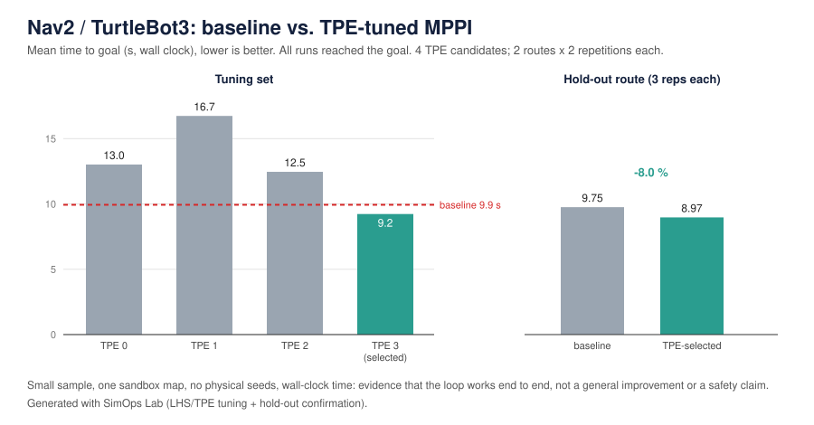

# SimOps Lab

**Turn an executable simulation into a reproducible evaluation and tuning loop.** SimOps Lab plans campaigns, runs experiments, applies per-run constraints, searches candidate configurations, and keeps the evidence needed to explain why a configuration passed or failed. An AI agent can operate the workflow through a local MCP server while execution and analysis remain reproducible outside the LLM.

> For mobile robots, SimOps helps take a navigation stack from its initial parameters to a configuration evaluated for a particular robot, map, and scenario set. It does not promise a mathematical optimum or certify safety. It makes the measurements, conditions, violated constraints, and remaining validation visible.

## What you can do

| Capability | Core | Nav2/TurtleBot3 example |
|---|---|---|
| Define robot × scenario × configuration × repetition × seed campaigns | JSON manifests and deterministic planner | Headless Gazebo Sim navigation route |
| Run, retry, cancel, and resume work | Concurrent runner, deadline, SQLite WAL journal | One isolated container per run |
| Preserve verifiable evidence | SHA-256 artifacts, attempts, configuration and backend provenance | Logs, YAML overrides, and structured measurements |
| Measure mission outcomes and operations | Versioned metrics with observed, missing, invalid, and not-applicable states | NavigateToPose action, wall/simulation duration, odometry, and laser data |
| Quantify route and control behavior | Generic metric contracts, summaries, and per-scenario coverage | Route-efficiency proxy, command rate, turns, saturation, and RMS angular acceleration |
| Tune parameters | Dependency-free LHS and optional TPE/Optuna; multiple objectives and Pareto results | Tuning connected to real runs and robot-profile limits |
| Keep averages from hiding failures | Worst-case constraints per run by default | Configurable success and speed constraints |
| Inspect results | Canonical JSON plus Markdown/HTML, quantiles, success intervals, and missing-data reporting | Local campaign reports |
| Let an agent operate the workflow | Local stdio MCP, workspace boundaries, allowlist, and quotas | `demo` is allowed by default; Docker must be enabled explicitly |
| Adapt another robot or domain | Installable Python backend entry point and capability profiles | The bundled Nav2 route is TurtleBot3-specific, not a universal adapter |

## Evaluation catalogue

The schema does not force every system into one score. Define the mission measures and acceptance criteria for your problem, retain missing values as missing, and inspect each scenario/configuration before aggregating results.

- **Mission and navigation:** success, terminal state, simulation/wall time, distance, route efficiency, final pose, deviation, and recoveries.
- **Safety:** contacts, collisions, footprint distance, near misses, time-to-collision, impact speed, and impulse.
- **Localization and sensors:** XY/yaw error against an independent reference, drift, freshness, dropouts, jitter, and latency.
- **Control and motion:** limits and saturation, oscillation, maneuvers, acceleration, jerk, smoothness, and post-mission stopping.
- **Robustness:** distributions across scenarios and seeds, worst cases, CVaR, sensitivity, out-of-sample performance, and holdout results.
- **System and reproducibility:** diagnostics, crashes, CPU/memory/GPU, clocks, data coverage, effective parameters, and artifact hashes.

The [metric catalogue](docs/metrics-catalog.md) distinguishes measures emitted by the Nav2 example from extensions that need additional instrumentation. In the demo, minimum laser range is **not** presented as safe clearance, odometry is **not** treated as independent ground truth, and missing contact data is **not** counted as zero collisions.

## Example result



The figure comes from one real run of the Nav2/TurtleBot3 example: a baseline, four TPE candidates, and a hold-out route kept out of the search. It shows the loop working end to end; with this sample size it is not evidence of a general improvement.

## Robot-aware tuning

1. Declare geometry, kinematic limits, and available sensors in a [robot profile](examples/robot-profiles/turtlebot3-demo.json).
2. Specify tunable parameters, screening scenarios, repetitions, seeds, and objectives.
3. Declare hard safety constraints per run. Worst-case aggregation is the default so that a favorable mean cannot hide an isolated failure.
4. Use LHS to cover the parameter space; use TPE when adaptive search is useful and a persistent study is available.
5. Inspect the Pareto front and scenario/configuration matrix.
6. Repeat finalists on reserved scenarios or seeds before claiming an improvement.

The [optimization guide](docs/optimization-methods.md) and [user manual](docs/user-manual.md) include examples. A robot profile bounds `controller.vx_max` and `controller.wz_max`; each backend remains responsible for applying parameters and reading back the effective values.

## Get started

```sh
python -m pip install -e .
simops profile validate examples/robot-profiles/turtlebot3-demo.json
simops validate examples/demo-campaign.json
simops run examples/demo-campaign.json
simops tune examples/demo-tuning.json
```

`demo` is synthetic and teaches the workflow. To run the included real simulator integration, install Docker and build the image:

```sh
docker build -f examples/nav2-turtlebot3/Dockerfile -t simops-lab/nav2-turtlebot3:lyrical-1.5.3-gm1.3.46 .
simops validate examples/nav2-turtlebot3/campaign.json
simops run examples/nav2-turtlebot3/campaign.json
```

Read the [user manual](docs/user-manual.md) before configuring an experiment. To use MCP locally, install `python -m pip install -e ".[mcp]"` and run `simops mcp --workspace ./workspace`; the server has no shell tool and only allows the synthetic backend by default. Install TPE with `python -m pip install -e ".[optimize]"`.

## Use it from an AI agent (MCP)

SimOps Lab runs as a local MCP server over stdio. No clone or manual install is needed with [`uv`](https://docs.astral.sh/uv/). First create a workspace with a demo manifest the agent can use:

```sh
mkdir -p ~/simops-workspace/manifests
curl -fsSL https://raw.githubusercontent.com/asolanieto/SimOpsLab/main/examples/demo-campaign.json -o ~/simops-workspace/manifests/demo-campaign.json
curl -fsSL https://raw.githubusercontent.com/asolanieto/SimOpsLab/main/examples/demo-tuning.json -o ~/simops-workspace/manifests/demo-tuning.json
```

Then register the server in your host.

**Claude Code**

```sh
claude mcp add simops -- uvx --from "simops-lab[mcp,optimize] @ git+https://github.com/asolanieto/SimOpsLab" simops mcp --workspace ~/simops-workspace
```

**Claude Desktop, Cursor, and other hosts** that read an `mcpServers` JSON file:

```json
{
  "mcpServers": {
    "simops": {
      "command": "uvx",
      "args": [
        "--from", "simops-lab[mcp,optimize] @ git+https://github.com/asolanieto/SimOpsLab",
        "simops", "mcp", "--workspace", "/home/you/simops-workspace"
      ]
    }
  }
}
```

**Codex** (`~/.codex/config.toml`)

```toml
[mcp_servers.simops]
command = "uvx"
args = ["--from", "simops-lab[mcp,optimize] @ git+https://github.com/asolanieto/SimOpsLab", "simops", "mcp", "--workspace", "/home/you/simops-workspace"]
```

Then ask the agent, for example: *"List the SimOps manifests, validate `demo-tuning.json`, run the tuning, and summarize the Pareto candidates."* Only the synthetic `demo` backend is enabled by default; add `--allow-backend nav2-docker` after building the Docker image to let the agent run Nav2. See [the MCP guide](docs/mcp.md) for tools and limits.

## Add support for your stack

Implement a backend plugin with `validate()` and `execute()` methods to translate parameters, start the simulator, collect signals, and return `RunResult` with source, coverage, and known limitations. Register it under the `simops.backends` entry point. See the [backend authoring guide](docs/backend-authoring.md) for instrumentation and isolation. The core does not assume ROS, Gazebo, or a navigation task.

## Product status

The core runtime, LHS/TPE search, and a Nav2 demonstration integration are implemented and covered by unit tests and smoke runs. The current demo does **not** yet include Gazebo contact instrumentation, an independent pose reference, footprint clearance, localization error, ROS diagnostics, or resource telemetry. SimOps is not a universal optimizer ready for every robot.

More stacks and scenarios, independent safety measurements, a second backend implementation, and external review of the manual remain open work. The included integration is a reproducible demonstration, not a safety certification or performance guarantee for other robots. The repository is distributed under the [Apache License 2.0](LICENSE). Example campaigns contain no local test data.

## Community and contributions

Read the [changelog](CHANGELOG.md) and [contribution guide](CONTRIBUTING.md) before proposing changes. Report security issues using [SECURITY.md](SECURITY.md); use the GitHub templates for questions and bugs.
